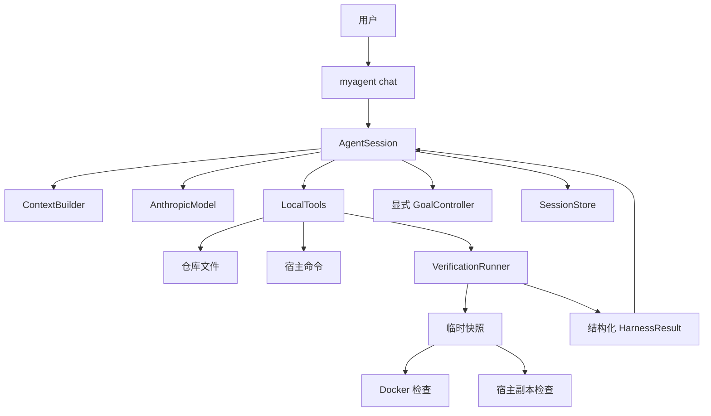

# myagent 整体架构

## 新 Runtime 内核

聊天链路使用稳定的运行时边界：

```text
CLI / HTTP -> AgentSession -> AgentLoop -> ModelClient -> Provider Adapter
                                  |
                                  v
                           ToolRegistry -> ToolExecutor -> LocalTools / Harness
```

`core` 只处理模型请求、工具调用配对、预算、取消和生命周期事件；`model` 只负责
Provider 协议转换；`tools_runtime` 负责工具定义、授权范围和执行结果；`session_runtime`
预留会话 API、状态编码和版本迁移；`infrastructure` 暴露持久化、进程和验证适配器。
聊天 Session、工具集合和 Harness 都从这些边界组合，不再依赖旧顶层模块。固定任务的
实现集中在 `legacy/benchmark`，`service/` 和 `evaluation/` 只通过明确适配器使用它们。

聊天 Session 默认注入 `HistoryCompactor`：原始历史与发送视图分离，模型生成摘要，内核
负责范围、工具配对、最近轮次保护和多层块合并。`ContextBuilder.fits()` 只读，
`build()` 才自动压缩。独立使用 Runtime 时仍可选择 `NoopCompactor`。
压缩状态与原始历史共同落盘；事件日志记录执行轨迹，状态文件仍是恢复依据。
具体协议和边界见 [上下文压缩](context-compression.md)。

显式开启 `--memory` 后，Session 通过独立记忆后端保存全局偏好和项目记忆。
每轮只召回一次并生成只读 `ContextSource` 快照，工作模型和评估器使用相同来源；
回答完成后复用本轮预算提取原始消息，SQLite 事务统一提交记忆、索引及水位。
记忆维护失败不改变已经完成的回答。详见 [原生长期记忆](memory.md)。

## 1. 产品边界

myagent 的唯一公开入口是 `myagent chat`。它围绕一个用户指定的本地仓库提供连续对话：模型可以阅读代码、修改普通文本文件、运行用户授权的宿主命令，并按需调用预先登记的 Harness 检查。

聊天 Agent 负责理解用户目标和推进工作；Harness 只负责产生检查证据，不嵌套启动另一个模型 Agent。固定任务、服务和评测模块仍在仓库中，但只作为内部迁移和回归材料。



## 2. 一次请求中的职责分工

一次普通输入的主链是：

```text
cli.main
  -> interfaces.cli.chat.run_chat
  -> session_runtime.session.AgentSession.submit
  -> 模型响应
  -> tools_runtime.builtin.LocalTools.dispatch（可能重复多轮）
  -> 保存 assistant / tool_result
  -> 返回回答并等待下一次输入
```

模型只提出工具请求，不能绕过工具协议直接改文件或注入 Harness 命令。运行时在工具分发时检查：

- 工具是否在本次启动中开放；
- 参数是否符合严格 schema；
- 路径是否处于仓库边界内；
- 文件摘要是否仍与最近一次读取一致；
- 本轮时间、模型调用、工具调用和 token 预算是否足够。

模型适配层只负责 Anthropic 兼容 Messages API、流式响应和错误归类；会话层不依赖 SDK 的具体对象。`prompts.py` 将综合 Agent 的通用职责与聊天策略分开，旧固定任务模式只额外使用 benchmark 策略。

## 3. 三种状态要分开

### 对话状态

消息、工具调用和工具结果组成模型上下文。每个工具结果都带回原来的 `tool_use_id`，保证模型知道哪个请求产生了哪个观察。

### 工作区状态

聊天直接操作用户仓库。文件工具保存首次修改前内容，修改前要求读取摘要；Harness 则复制当前仓库到临时目录，在副本中执行检查，不把检查过程中的文件变化写回用户目录。

### 证据状态

命令结果和 Harness 结果记录退出码、状态、输出摘要、快照摘要和产物路径。`passed` 只表示登记检查成功，不能被包装成隐藏验收或绝对正确性。

## 4. 关键模块

| 模块 | 主要职责 |
| --- | --- |
| `interfaces/cli` | 参数解析、权限开关、环境文件和交互输入 |
| `core` | Agent Loop、预算、取消、上下文、事件和内部类型 |
| `model` | Provider 无关模型端口与 Anthropic 适配器 |
| `tools_runtime` | 工具注册、schema、执行和内置文件/命令/Harness 工具 |
| `session_runtime` | 多轮消息、Goal、恢复、ContextBuilder 和状态协调 |
| `infrastructure/persistence` | version 1 状态保存、事件追加和会话锁 |
| `infrastructure/process` | 参数数组进程、超时、输出上限和进程树回收 |
| `infrastructure/verification` | Harness 配置、快照、宿主/Docker 后端和证据产物 |

## 5. 当前不属于产品入口的部分

`legacy/benchmark`、`service/` 和 `evaluation/` 保留了固定任务、服务化执行和批量评测能力。它们帮助维护历史回归，但不会被 `chat` 自动调用，也不会向普通用户暴露旧命令。

通用检查通过进程内 `VerificationRunner` 运行。固定任务的 acceptance 和 JUnit 分类仍由旧兼容适配器使用；两条链路共享 Docker 能力，但不会把固定任务的完整模型循环嵌入聊天。
