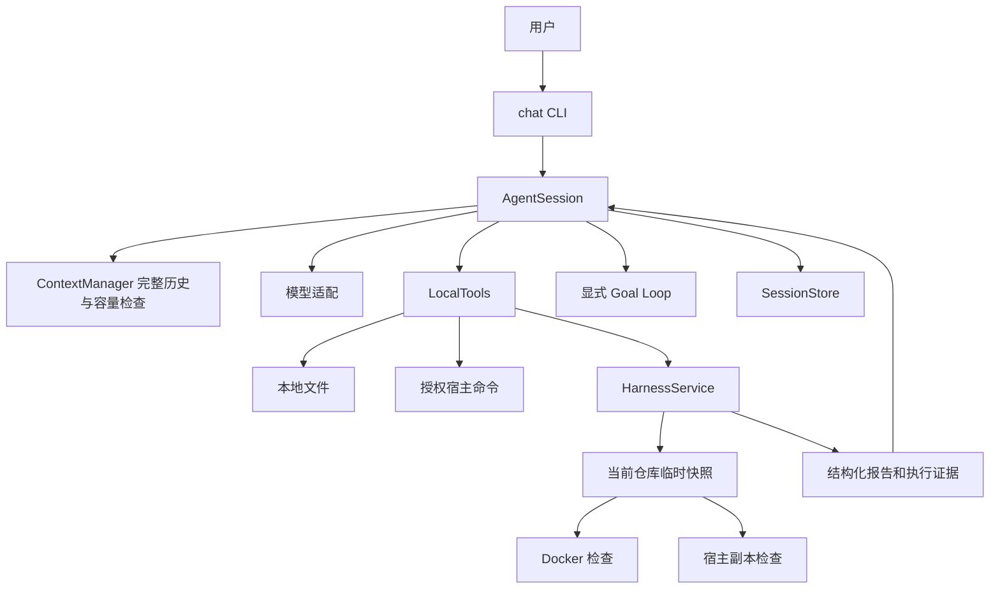

# 聊天 Agent 与通用 Harness

## 单一用户入口

`patchpilot chat` 是唯一公开命令。用户通过同一个会话提问、分析代码、修改仓库并按需检查。没有固定任务 Agent 嵌套调用，也不要求 `task.json`、PostgreSQL 或 Docker 才能聊天。

## 职责与接口

| 模块 | 职责 |
| --- | --- |
| `cli.py` / `chat_cli.py` | 交互参数、API/命令/Harness 授权、新建与恢复、中文进度 |
| `session.py` | 单模型工具循环、调用配对、预算、取消、目标和会话保存 |
| `runtime.py` / `anthropic_model.py` | 共用预算、模型协议、安全故障分类、Anthropic 兼容请求 |
| `prompts.py` | 综合开发职责，以及聊天策略与内部基准策略 |
| `context.py` | 消息追加与容量判断；未来压缩接在此边界，当前保留完整历史 |
| `local_tools.py` | 公开文件路径、读取摘要、防覆盖、本地工具与 Harness 工具分发 |
| `harness.py` | profile 配置、当前代码快照、环境选择、检查和报告、内部基准适配 |
| `process_runner.py` / `process_job.py` | 参数数组执行、输出上限、超时、中断和进程树回收 |
| `goal.py` / `session_store.py` | 无工具目标评估、完整记录、原子保存和会话锁 |

聊天只依赖通用运行时类型；旧 `agent.py` 使用相同核心提示词和类型，但只承担内部固定任务兼容。综合 Agent 的主循环在 `AgentSession`，不是修改旧循环让它额外充当聊天循环。

## Harness 的执行边界

`run_harness_check(profile)` 只接受登记名称。工具 schema 显示启动时加载的 profile；配置在启动时冻结，工具调用不能通过参数注入新命令。配置、镜像和项目检查脚本属于用户授权的控制面。

Harness 在当前工作区建立临时副本，按实际复制的文件内容绑定摘要，包含用户已有修改和本会话修改，不依赖 Git。manifest 与冻结配置随报告保存。凭据、依赖、缓存、会话产物和维护者材料默认跳过。

`auto` 在配置镜像不可用时可按授权降级宿主；检查开始后失败不会切换环境重试。`docker` 必须隔离执行，`host` 明确标记本地证据。Docker 复用原沙箱的镜像校验，锁定镜像 ID，并限制网络、资源、用户、挂载与清理范围。宿主与原命令工具共用进程执行器。

宿主执行只通过副本隔开正常相对文件写入，不隔离恶意代码。项目脚本仍有当前用户权限，不能用 `isolated=false` 的结果声称已隔离验收。进程环境不直接继承 API 密钥，Python 默认使用当前解释器并优先导入快照路径；依赖需预先准备。

返回的 `passed` 仅意味着本次登记命令退出码为零。一般项目没有独立维护者验收，不能把零退出码或目标评估误写成可信基准评分。失败、超时、取消、基础设施和清理异常分别记录，产物保存在本会话 `harness/` 下。

## 对话、目标与恢复

普通用户提交结束后等待下一次输入。目标模式在工作模型结束时调用独立无工具评估器，评估器检查现有聊天与工具证据，缺少项反馈给工作模型。模型请求和评估请求共享预算；工具时间传递本轮剩余时限。

完整工具调用先落盘，结果随后配对保存。恢复仅补齐缺失结果，不执行历史命令或检查；目标默认暂停，读取摘要授权清空。权限按本次启动重新授予，旧会话仍能恢复。没有自动压缩或静默删除历史；达到上下文阈值后提示 `/new`。

## 内部兼容与扩展

旧 `task.py`、固定任务工具、服务、评测和 Docker pytest 后端保留为内部迁移资料与回归。`verify_patch` 通过统一 Harness 的基准适配入口调用固定快照和维护者验收后端；这个分支不向聊天模型开放，也不成为公开 CLI。

未来压缩通过 `ContextManager` 扩展，MCP 通过 Harness 的薄协议适配层扩展。当前不引入这些功能，也不引入第二个模型 Agent。
