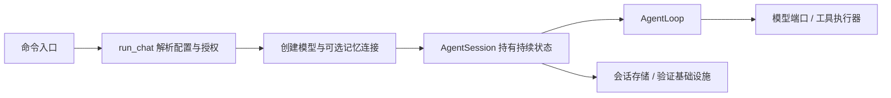

# C01 入口与架构：一次对话怎样获得执行能力

> 课程性质：核心
> 返回：[导学](../PatchPilot/导学.md)；前置：Python 基础；下一课：[C02](02-模型与工具循环.md)。
> 对应：简介；[Q1 项目介绍](../PatchPilot/面经.md#q1-项目定位与架构)；目标掌握：看懂链路、理解机制、设计与表达。

## 本课重点

开发者提交“读一下项目并修改某个函数”时，先发生的是宿主依赖组装，再由模型决定工具请求。CLI 持有资源生命周期，会话持有持续状态，核心循环只处理一次模型与工具往返。主链是同步串行的，模型 SDK 内部使用异步网络请求，不等于会话支持多轮并发。

当前仓库有公开聊天、内部固定任务服务、批量评测三种使用形态。把它们讲成一个全部统一的运行时，会错误解释恢复、工具权限和验收行为。

## 主链与职责

模型是决策者；工具执行器是动作边界；Session 是协调者。端口把核心数据结构与具体 SDK 分开，替换模型实现主要落在适配层，但仍须满足消息、停止原因和 usage 语义。

## 源码阅读

| 顺序 | 文件与符号 | 阅读目的与下一跳 |
| --- | --- | --- |
| 1 | [pyproject.toml](../../pyproject.toml) 的 `project.scripts` | 两个命令名都进入同一个 CLI；继续读参数路由 |
| 2 | [main.py](../../src/patchpilot/interfaces/cli/main.py) 的 `main` | 公开子命令当前只有 chat；不是服务 API 的启动入口 |
| 3 | [chat.py](../../src/patchpilot/interfaces/cli/chat.py) 的 `run_chat` | 检查 API 授权，加载环境，创建预算与资源，循环提交输入 |
| 4 | [session.py](../../src/patchpilot/session_runtime/session.py) 的 `AgentSession.__init__` | 绑定存储、上下文、工具、目标；开启记忆失败时允许普通对话继续 |
| 5 | [protocol.py](../../src/patchpilot/model/protocol.py) 的 `ModelClientAdapter.complete` | 将 SDK 形态转换成核心请求/响应；继续 C02 |

适配器真正做的是数据转换：把旧模型接受的关键字参数转发出去，将 SDK block 转成普通字典，将 usage 转成 `ModelUsage`。核心循环因而无须 import 具体 SDK。`Protocol` 只是接口契约；它不会像 Pydantic 那样在运行时自动验证任意实现。

## 机制与边界

依赖注入体现在会话接受模型、存储、预算、事件回调和记忆后端，以及循环接受工具执行器、时钟和 checkpoint 回调。测试可以注入假模型复现确定的工具序列，无须真实 API；这也是模型不可预测时仍能验证宿主状态机的关键。

`run_chat` 使用资源管理关闭模型和记忆连接；会话关闭时保存状态并释放锁。构造失败也必须释放已经取得的会话锁，否则下一次恢复可能被误阻塞。

`--allow-api`、`--allow-commands`、`--allow-harness` 和 `--memory` 控制不同能力。允许联网调用模型不会自动允许宿主命令。恢复时权限由本次启动参数重新绑定，存储的元数据不能自行授予执行能力。

内部服务的 `AgentExecutor` 和评测仍进入旧固定任务循环；[SessionManager](../../src/patchpilot/session_runtime/manager.py) 只是工厂调用。若重新统一，需要先把事件形状、工具返回、验收触发和恢复状态契约对齐，而非仅替换一个函数名。这是演进分析，当前尚未完成。

## 需要懂什么

分层的实际收益是依赖方向可控：核心循环理解消息和动作，不需要知道如何写 SQLite 或如何启动终端。Session 可以协调能力，但不应把每种底层副作用的实现都放进去。替换 Provider 也不等于模型行为完全一致，工具协议、thinking block 和服务端计费仍有差异。

同步会话让状态转换和保存点容易推理，代价是一次长工具执行期间不能接受另一轮提交。API 或 UI 若需要流式交互，可以消费已有事件，但多轮并发仍需要额外的状态协调。

## 需要记住什么

- 公开入口：命令 → CLI → Session → 核心循环；内部任务与评测保留另一条循环。
- 会话持有原始历史、目标、摘要块、统计与文件基线；循环持有本轮计数和往返过程。
- 接口抽象便于替换与测试，运行时参数校验仍在明确边界完成。

回到 [Q1](../PatchPilot/面经.md#q1-项目定位与架构)，先解释用户能做什么，再讲上述分工。
